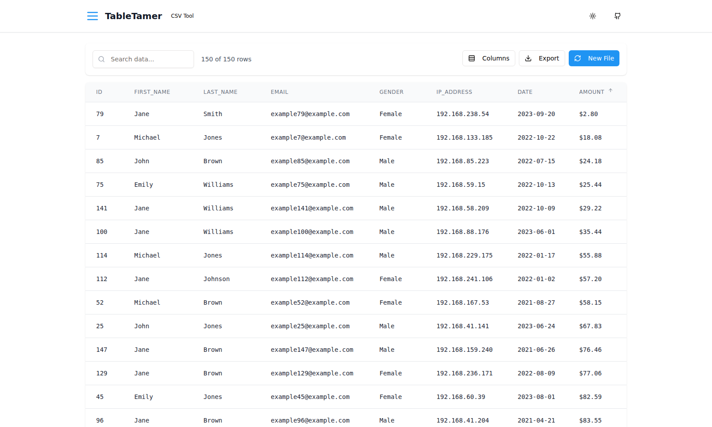

# 📊 TableTamer

**Turn a CSV file into a table you can search, sort, edit and export, all in your browser.**

<p>
  
  
  
  
  <a href="https://github.com/hexawulf/tabletamer/actions/workflows/ci.yml"></a>
  <a href="LICENSE"></a>
</p>

**Live:** [tabletamer.piapps.dev](https://tabletamer.piapps.dev)



## Contents

- [Features](#features)
- [How your data is handled](#how-your-data-is-handled)
- [Keyboard shortcuts](#keyboard-shortcuts)
- [Quick start](#quick-start)
- [Scripts](#scripts)
- [Configuration](#configuration)
- [Project layout](#project-layout)
- [Deployment](#deployment)
- [Tech stack](#tech-stack)
- [Version history](#version-history)
- [Contributing](#contributing)
- [License](#license)

## Features

**Load**

- Drag and drop a `.csv` file, or click to choose one.
- Try the app at once with the built-in example data set (150 rows).
- Rows with a different number of fields still load. You get a warning instead of an error.

**Explore**

- Search across all columns.
- Click a column header to sort. Sorting knows numbers, money values and dates, is stable, and always puts empty cells last. Dates with slashes are read day-first.
- Drag a header edge to resize a column.
- Show or hide columns in the **Columns** dialog.
- Page through the data with 10, 25, 50 or 100 rows per page.

**Edit**

- Click a cell to edit it. An edited cell keeps its place until you sort again.
- Apply a text transform before you save: UPPERCASE, lowercase, Title Case, or clear.

**Export**

- Export the filtered, visible data as CSV or JSON.
- Copy the data to the clipboard as JSON.
- Cells that start with `=`, `+`, `-` or `@` are escaped in CSV exports, so a spreadsheet does not run them as formulas.

**General**

- Light and dark theme.
- Your last table comes back after a reload (from `localStorage`).
- An error boundary keeps a rendering error from blanking the whole page.

## How your data is handled

- CSV files are parsed **in your browser** with PapaParse. They are never uploaded. The server only delivers the app.
- Values stay exactly as they are in the file. Leading zeros, long IDs, `1e3` and `TRUE` are not converted, so a CSV export gives back the same text.
- The current table is kept in your browser's `localStorage`. If the file is too large for the storage quota, the table still works, and a message tells you it will not be restored after a reload.
- There are no accounts, no analytics and no database.

## Keyboard shortcuts

| Action                | Shortcut          |
| --------------------- | ----------------- |
| Focus search          | `Ctrl/Cmd + F`    |
| Open column manager   | `Ctrl/Cmd + M`    |
| Show shortcuts dialog | `Ctrl/Cmd + K`    |
| Export CSV            | `Alt + Shift + E` |
| Toggle theme          | `Alt + Shift + D` |
| Next page             | `→`               |
| Previous page         | `←`               |
| Clear search          | `Esc`             |

Export and theme use `Alt + Shift` so that they do not clash with the browser's own `Ctrl + E` and `Ctrl + D`.

## Quick start

You need **Node.js 22 or later** and npm.

```bash
git clone https://github.com/hexawulf/tabletamer.git
cd tabletamer
npm ci
npm run dev        # http://127.0.0.1:5000 with Vite hot reload
```

Production build:

```bash
npm run build      # client → dist/public, server → dist/index.js
npm start          # NODE_ENV=production node dist/index.js
```

## Scripts

| Script                  | What it does                                       |
| ----------------------- | -------------------------------------------------- |
| `npm run dev`           | Start the Express server with Vite in dev mode     |
| `npm run build`         | Build the client with Vite and bundle the server   |
| `npm start`             | Run the production build from `dist/`              |
| `npm test`              | Run the Vitest suite once                          |
| `npm run test:watch`    | Run Vitest in watch mode                           |
| `npm run test:coverage` | Run the tests with V8 coverage                     |
| `npm run test:e2e`      | Playwright smoke test against the production build |
| `npm run test:e2e:live` | Same smoke test against tabletamer.piapps.dev      |
| `npm run lint`          | ESLint (flat config)                               |
| `npm run check`         | TypeScript type check (`tsc`)                      |
| `npm run format`        | Format the project with Prettier                   |

A Husky pre-commit hook runs Prettier on staged files. CI (GitHub Actions, Node 22 and 24) runs lint, type check, tests and build on pushes to `main` and on pull requests, and a separate job runs `npm audit` on the production dependencies.

## Configuration

The server reads these environment variables. It does not load a `.env` file by itself, so set them in your shell or in the pm2 ecosystem file.

| Variable        | Default               | Purpose                                 |
| --------------- | --------------------- | --------------------------------------- |
| `PORT`          | `5000`                | Port to listen on                       |
| `HOST`          | `127.0.0.1`           | Address to bind; keep it behind a proxy |
| `NODE_ENV`      | (none)                | `production` serves the built client    |
| `LOG_FILE_PATH` | `logs/tabletamer.log` | Winston log file                        |

## Project layout

```text
client/              React app (Vite)
  src/context/       TableContext: loading, sorting, filtering, editing, export, persistence
  src/components/    TableView, FileUpload, CellEditor, ColumnManager, About, shortcuts
  src/lib/           Column type detection and sort comparators, with unit tests
server/              Express server: static files, cache headers, /api JSON 404
public/              Favicons and web manifest
screenshots/         Images used in this README
ecosystem.config.cjs pm2 process definition
```

## Deployment

TableTamer runs on piapps under pm2, behind nginx with TLS.

```bash
git pull --ff-only origin main
npm ci
npm run build
pm2 restart tabletamer      # use pm2 start ecosystem.config.cjs the first time
```

Notes:

- The server binds to `127.0.0.1:5000`. nginx proxies to it.
- `ecosystem.config.cjs` sets `HOST`, `PORT` and `NODE_ENV`, and turns pm2 watch off, so a rebuild does not restart the app halfway through.
- Hashed files under `/assets/` are sent with a one-year `immutable` cache header. `index.html` is sent with `no-cache`, so a new release shows up at once.
- Helmet sets the security headers, and `x-powered-by` is off. Any `/api/*` path returns a JSON 404, because there is no API.
- `GET /healthz` returns `200 {"status":"ok"}` for uptime monitors.

Check a deploy:

```bash
pm2 status tabletamer
ss -ltnp | grep ':5000 '                                     # must show 127.0.0.1:5000
curl -sS -o /dev/null -w '%{http_code}\n' http://127.0.0.1:5000/healthz   # 200
```

`pm2 status` alone is not enough: in v1.1.0 the process showed `online` but never opened the port.

## Tech stack

- **Frontend:** React 18, TypeScript, Vite 7, Tailwind CSS 3, Radix UI primitives (shadcn/ui style), Lucide icons, Wouter
- **Data:** PapaParse, browser `localStorage`, Clipboard API
- **Server:** Express 4, Helmet, compression, Winston
- **Tooling:** Vitest, Testing Library, Supertest, Playwright, ESLint 9, Prettier, Husky, lint-staged, esbuild

## Version history

See [CHANGELOG.md](CHANGELOG.md) for details.

| Version   | Date       | Highlights                                                                                                  |
| --------- | ---------- | ----------------------------------------------------------------------------------------------------------- |
| **1.2.1** | 2026-11-20 | Fix: security headers sent once (nginx duplicates removed)                                                  |
| **1.2.0** | 2026-11-20 | Playwright smoke test in CI, SHA-pinned Node 24 actions, Dependabot, SECURITY.md                            |
| **1.1.2** | 2026-11-18 | Removed unused server dependencies (`cors`, `express-rate-limit`)                                           |
| **1.1.1** | 2026-11-18 | Fix: the server starts listening under pm2                                                                  |
| **1.1.0** | 2026-11-18 | Audit fixes: no value coercion, type-aware sorting, storage-quota safety, formula-safe export, tests and CI |
| **1.0.0** | 2025-05-13 | First release                                                                                               |

Older security notes are in [SECURITY_AUDIT.md](SECURITY_AUDIT.md).

## Contributing

Contributions are welcome. Keep changes small and tested:

1. Fork the repository and create a branch.
2. Make your change, and add a test when it changes behaviour.
3. Run `npm run lint && npm run check && npm test && npm run build && npm run test:e2e`
   (first time: `npx playwright install chromium`).
4. Open a pull request.

## License

[MIT](LICENSE) © 0xWulf · [dev@0xwulf.dev](mailto:dev@0xwulf.dev)
